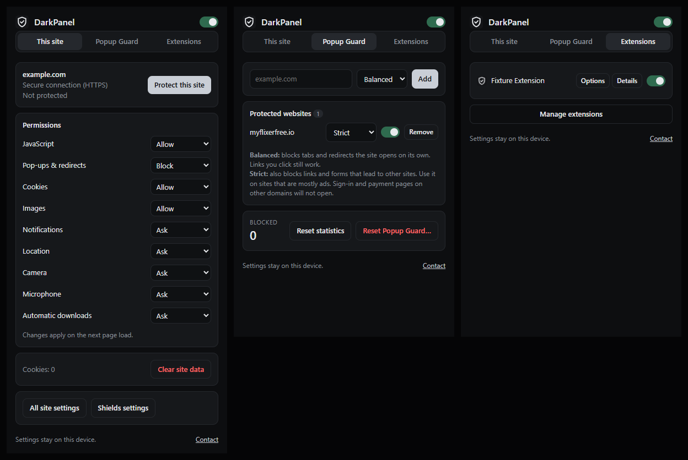

# DarkPanel

A browser extension for Brave (and other Chromium browsers) that stops the popups, new tabs and redirects that streaming and download sites open behind your back. It also puts each site's permissions and your extensions in one panel.

The repository also contains **Graphite Dark**, a black/graphite browser theme, and an optional policy file that turns off Brave Wallet, Leo AI, Brave News, Brave VPN and Brave Rewards.

Everything runs locally. DarkPanel has no account, no analytics and makes no network requests.



## Contents

- [What it does](#what-it-does)
- [Install DarkPanel](#install-darkpanel)
- [Install the Graphite Dark theme](#install-the-graphite-dark-theme)
- [Turn off Brave Wallet, Leo, News, VPN and Rewards (optional)](#turn-off-brave-wallet-leo-news-vpn-and-rewards-optional)
- [Using DarkPanel](#using-darkpanel)
- [Update](#update)
- [Uninstall](#uninstall)
- [Mobile](#mobile)
- [Limitations](#limitations)
- [Development](#development)
- [Contact](#contact)
- [License](#license)

## What it does

**Popup Guard.** Add a website once; from then on that site can't open tabs, windows or redirects by itself.

- Blocked: popups, popunders, tabs opened by buttons or invisible overlays, `target="_blank"` ad links, script and meta-refresh redirects to other sites, and popups from ad frames inside the page.
- Still works: Ctrl+T, typing an address, bookmarks, Ctrl+click and middle-click, "Open link in new tab", normal links on the site, video playback, fullscreen and keyboard shortcuts.
- Two modes per site:
  - **Balanced** (default): blocks what the site opens on its own. Links you click still work.
  - **Strict**: also blocks links and forms that lead to other sites, even when you click them. Use it on sites that are mostly ads. Sign-in and payment pages hosted on other domains won't open.
- `myflixerfree.io` is preset to Strict. Sites you haven't added are never affected.

**This site.** The current site's connection status (HTTPS or not), and per-site permissions for JavaScript, pop-ups, cookies, images, notifications, location, camera, microphone and automatic downloads. Also a cookie count, a "Clear site data" button, and shortcuts to the full site settings and to Shields.

**Extensions.** All installed extensions with their icons, an on/off switch, and Options and Details buttons. You can use this instead of the puzzle-piece menu.

## Install DarkPanel

DarkPanel isn't in the Chrome Web Store yet, so you install it in developer mode. This takes about two minutes.

1. Download the latest `darkpanel-<version>.zip` from the [Releases](https://github.com/darkzmaj/DarkPanel/releases) page.
2. Extract it to a folder you'll keep, for example `Documents\DarkPanel`. The browser loads the extension from this folder, so don't delete or move it later.
3. Open `brave://extensions` (in Chrome: `chrome://extensions`).
4. Turn on **Developer mode** (switch in the top-right corner).
5. Click **Load unpacked** and select the folder from step 2: the one that contains `manifest.json`.
6. Click the puzzle-piece icon in the toolbar and click the pin next to **DarkPanel**.

Alternatively, clone the repository and select `extensions/dark-panel` in step 5.

Brave may show a "developer mode extensions" notice on startup. That's normal for extensions you didn't install from a store.

## Install the Graphite Dark theme

The theme changes colors only: tabs, toolbar, address bar and the new-tab page. Brave themes can't move or hide buttons.

1. Download `graphite-dark-<version>.zip` from [Releases](https://github.com/darkzmaj/DarkPanel/releases) and extract it to a folder you'll keep.
2. Open `brave://extensions` with Developer mode on, click **Load unpacked**, and select that folder.
3. The theme applies immediately.
4. For dark menus and settings pages too: open `brave://settings/appearance` and set the color mode to **Dark**.

To go back to the default look: `brave://settings/appearance` → **Reset to default** next to Theme.

## Turn off Brave Wallet, Leo, News, VPN and Rewards (optional)

Brave supports official policies that switch these features off completely. They're in `brave-policies/` (Windows only).

1. Download `brave-policies/disable-brave-extras.reg` from this repository.
2. Double-click it, allow the administrator prompt, and confirm.
3. Restart Brave.

The file also turns off Brave's anonymous usage statistics (P3A) and usage ping. Afterwards Brave shows "Managed by your organization" in its menu; that's how Brave labels any policy and is expected.

To undo: double-click `brave-policies/enable-brave-extras.reg` and restart Brave.

On macOS and Linux, set the same policies (`BraveWalletDisabled`, `BraveAIChatEnabled`, `BraveNewsDisabled`, `BraveVPNDisabled`, `BraveRewardsDisabled`, `BraveP3AEnabled`, `BraveStatsPingEnabled`) following Brave's group policy guide on [support.brave.com](https://support.brave.com/) (search for "group policy").

## Using DarkPanel

### Protect a site
1. Open the site, then click the DarkPanel icon.
2. On **This site**, click **Protect this site**.
3. Reload the site's open tabs.

You can also add a site on the **Popup Guard** tab: type or paste `example.com`, `www.example.com` or `https://example.com/any/page`, pick a mode, and click **Add**.

A rule for `example.com` also covers its subdomains (`www.example.com`, `player.example.com`), but never unrelated sites such as `notexample.com` or `example.com.evil.net`.

### Change, pause or remove a site
On the **Popup Guard** tab, each site has a mode menu (Balanced or Strict), an on/off switch, and a **Remove** button. The switch in the panel's header turns Popup Guard off everywhere without losing your list.

Changes apply to pages loaded afterwards, so reload tabs that are already open.

### Blocked counter
The Popup Guard tab shows how many popups and redirects have been blocked. **Reset statistics** sets it to zero. **Reset Popup Guard** restores the default list and clears the counter, and asks you to click a second time to confirm. It doesn't touch any other browser settings. Nothing is counted in private windows.

### Site permissions
On **This site**, pick Allow, Block or Ask for each permission, then reload the page. **Clear site data** removes the site's cookies and storage (click twice to confirm).

### Extensions
The **Extensions** tab lists your other extensions. Use the switch to turn one on or off, **Options** to open its settings, and **Details** for its page in `brave://extensions`.

## Update

1. Download and extract the new release over the same folder (replace the files).
2. Open `brave://extensions` and click the reload arrow on the DarkPanel card.

Your list of sites and settings are kept.

## Uninstall

`brave://extensions` → **Remove** on the DarkPanel card (and on Graphite Dark). This deletes the site list and statistics stored by the extension. Then you can delete the folder.

## Mobile

DarkPanel runs in Android browsers that support Chrome extensions, such as Vivaldi, Lemur and Quetta. It's tested in a phone simulation only (desktop Chromium emulating a 360 px touch screen), not yet on a real phone.

- On touch screens the panel switches to 44 px tap targets and fits a 360 px screen.
- Popup Guard blocks tabs and ad links opened by taps the same way it blocks clicks.
- "Open in new tab" from the long-press menu uses the same code path as the right-click menu on desktop, but the long-press menu itself can't be simulated, so it's untested.

Not supported: Brave, Chrome and Opera on Android or iOS (no extension support yet), and iPhone browsers in general (would need a separate Safari extension). The Graphite Dark theme and the policy files are desktop-only.

## Limitations

- **Brave's own UI can't be changed by extensions.** DarkPanel can't center the address bar or bookmarks, move or hide Brave's built-in buttons, or add items to Brave's menu or to the menu behind the lock icon.
- **Other extensions' popups** can't be opened from the Extensions tab; browsers don't allow it. Use their pinned icon instead.
- **Popups from ad frames** inside a page are closed right after they open rather than prevented, so a tab can flash for a moment.
- **Redirects done by the website's server** to another site are allowed in Balanced mode and blocked in Strict mode.
- **Brave Shields** stays responsible for blocking ads and trackers in general. DarkPanel only acts on the sites you add.
- **Site permission changes made in DarkPanel** override the browser's defaults for that site. To return a site to its defaults, use **All site settings** → **Reset permissions**.

How the blocking works in detail: [docs/POPUP_GUARD.md](docs/POPUP_GUARD.md).

## Development

Requirements: Node.js 22 or later.

```bash
npm ci
npx playwright install chromium   # once, for the browser tests
npm test                          # unit tests
npm run test:e2e                  # browser tests (headless Chromium, local test pages)
npm run package                   # dist/darkpanel-<version>.zip and dist/graphite-dark-<version>.zip
npm run icons                     # re-render icons from assets/icon.svg
```

The browser tests serve local pages under made-up `*.test` domains and turn off Chromium's own popup blocker, so every block they see comes from DarkPanel. To use a specific Chromium build, set `TEST_CHROMIUM` to its executable path.

Project layout:

```
extensions/dark-panel/   the extension (manifest V3)
  core/                  rule model, matching and storage (no browser APIs; unit-tested)
  content/               scripts injected into protected sites
  ui/                    the panel
themes/graphite-dark/    the theme
brave-policies/          optional Windows policy files
tests/                   unit and browser tests
scripts/                 packaging, icons, test helpers
```

See [CONTRIBUTING.md](CONTRIBUTING.md) before opening a pull request, and [RELEASING.md](RELEASING.md) for publishing a release.

## Contact

Questions, bug reports or ideas: [darkzmaj.eu](https://darkzmaj.eu/#contact). Security issues: see [SECURITY.md](SECURITY.md).

## License

[MIT](LICENSE). Brave is a trademark of Brave Software, Inc.; DarkPanel isn't affiliated with Brave Software or Google.
